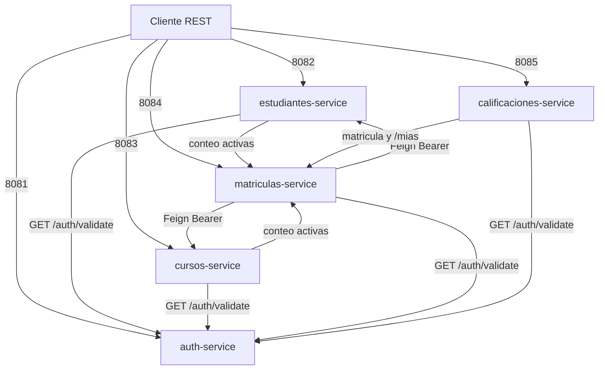

# Proyecto S3 - Sistema Distribuido de Gestión Académica

Cinco microservicios Spring Boot 3.2.5 (Java 21) separan identidad, estudiantes, cursos, matrículas y calificaciones. Cada proceso tiene su propia base H2 en memoria y su propio puerto. No hay una base compartida: las referencias entre agregados son identificadores `Long` y las lecturas cruzadas se hacen con OpenFeign.

La imagen de ejecución es `eclipse-temurin:21-jre`. El Dockerfile copia un JAR ya empaquetado. Docker Compose publica los puertos en el host y une los contenedores en la red `proyecto-s3_default`. Las URLs internas usan el nombre DNS del servicio (`http://auth-service:8081` y equivalentes). `depends_on` ordena el arranque y no espera a que el puerto acepte tráfico.

## Matriz de servicios y puertos

| Servicio | Puerto host:contenedor | Base H2 | Responsabilidad |
|---|---|---|---|
| auth-service | 8081:8081 | authdb | Login BCrypt y JWT HS256 |
| estudiantes-service | 8082:8082 | estudiantesdb | CRUD de estudiantes y correo único |
| cursos-service | 8083:8083 | cursosdb | CRUD de cursos y cupo máximo |
| matriculas-service | 8084:8084 | matriculasdb | Alta, anulación y conteo de matrículas activas |
| calificaciones-service | 8085:8085 | calificacionesdb | Notas por corte y promedio ponderado |

## Requisitos de entorno

- Java 21
- Maven 3.9+
- Docker Desktop o Docker Engine con Compose

El empaquetado puede hacerse en un contenedor Maven si el host no tiene Maven en el `PATH`.

## Instrucciones de despliegue

Compilación de los JAR:

```powershell
docker run --rm -v "${PWD}:/app" -w /app maven:3.9.9-eclipse-temurin-21 bash -c "cd auth-service && mvn clean package -DskipTests && cd ../estudiantes-service && mvn clean package -DskipTests && cd ../cursos-service && mvn clean package -DskipTests && cd ../matriculas-service && mvn clean package -DskipTests && cd ../calificaciones-service && mvn clean package -DskipTests"
```

Ejecución del stack:

```powershell
docker compose up --build -d
```

Pruebas, desde el directorio de cada servicio:

```powershell
mvn test
```

## Diagrama de red


